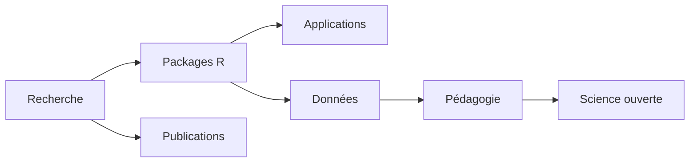

# Aurélien Nicosia

[English version](#english-version)

Chargé d'enseignement en mathématiques et statistiques à l'Université Laval, je développe un écosystème ouvert de recherche, de logiciels scientifiques et de ressources pédagogiques en statistique computationnelle, science des données reproductible et programmation R.

Mon travail relie méthodes statistiques, packages R, dépôts de reproduction, jeux de données québécois, applications interactives et enseignement de la science des données.

## Axes

- Estimation de densité et détection d'anomalies
- Statistique circulaire et directionnelle
- Modélisation du mouvement, HMM, SSF et validation générative
- Interprétation statistique et IA
- Pédagogie statistique ouverte et science des données reproductible

## Projets phares

| Projet | Rôle |
|---|---|
| [GLBFP](https://github.com/AurelienNicosiaULaval/GLBFP) | Estimation de densité par General Linear Blend Frequency Polygon |
| [ggcircular](https://github.com/AurelienNicosiaULaval/ggcircular) | Visualisation de données circulaires et directionnelles avec ggplot2 |
| [CircularRegression](https://github.com/AurelienNicosiaULaval/CircularRegression) | Régression circulaire-linéaire pour données directionnelles |
| [Validation-SSF](https://github.com/AurelienNicosiaULaval/Validation-SSF) | Validation générative de modèles de sélection de pas |
| [gmov](https://github.com/AurelienNicosiaULaval/gmov) | Diagnostics génératifs pour modèles SSF et iSSF |
| [donnees-bleues](https://github.com/AurelienNicosiaULaval/donnees-bleues) | Jeux de données québécois pour l'enseignement de la statistique |
| [tutorizeR](https://github.com/AurelienNicosiaULaval/tutorizeR) | Conversion de documents R Markdown et Quarto en tutoriels interactifs |
| [contextR](https://github.com/AurelienNicosiaULaval/contextR) | Projet émergent d'interprétation contextuelle d'analyses statistiques |

## Carte de l'écosystème

## Ressources pédagogiques

- [STT-1100 - Introduction à la science des données](https://github.com/AurelienNicosiaULaval/STT-1100_notes_de_cours)
- [STT-4230 / STT-6230 - Programmation pour la science des données](https://github.com/AurelienNicosiaULaval/programmation-pour-la-science-des-donnees)
- [Données bleues](https://aureliennicosiaulaval.github.io/donnees-bleues/)
- [Ressources SSD](https://aureliennicosiaulaval.github.io/site_ressources_SSD/)

## Liens

- Site personnel : <https://aureliennicosiaulaval.github.io/web_site/>
- ORCID : <https://orcid.org/0000-0002-0974-9988>
- LinkedIn : <https://ca.linkedin.com/in/aur%C3%A9lien-nicosia-6a52487b/>

---

## English version

Lecturer in Mathematics and Statistics at Université Laval, I develop an open ecosystem of research, scientific software and teaching resources in computational statistics, reproducible data science and R programming.

My work connects statistical methods, R packages, reproducible research repositories, Québec teaching datasets, interactive applications and data science education.

## Research axes

- Density estimation and anomaly detection
- Circular and directional statistics
- Movement modelling, HMMs, SSFs and generative validation
- Statistical interpretation and AI
- Open statistical education and reproducible data science

## Featured projects

| Project | Role |
|---|---|
| [GLBFP](https://github.com/AurelienNicosiaULaval/GLBFP) | Density estimation via General Linear Blend Frequency Polygon |
| [ggcircular](https://github.com/AurelienNicosiaULaval/ggcircular) | ggplot2 extension for circular and directional data |
| [CircularRegression](https://github.com/AurelienNicosiaULaval/CircularRegression) | Circular-linear regression for directional data |
| [Validation-SSF](https://github.com/AurelienNicosiaULaval/Validation-SSF) | Generative validation of step-selection models |
| [gmov](https://github.com/AurelienNicosiaULaval/gmov) | Generative diagnostics for SSF and iSSF models |
| [donnees-bleues](https://github.com/AurelienNicosiaULaval/donnees-bleues) | Québec teaching datasets for statistics education |
| [tutorizeR](https://github.com/AurelienNicosiaULaval/tutorizeR) | Conversion of R Markdown and Quarto documents into interactive tutorials |
| [contextR](https://github.com/AurelienNicosiaULaval/contextR) | Emerging project for contextual interpretation of statistical analyses |

## Teaching resources

- [STT-1100 - Introduction to data science](https://github.com/AurelienNicosiaULaval/STT-1100_notes_de_cours)
- [STT-4230 / STT-6230 - Programming for data science](https://github.com/AurelienNicosiaULaval/programmation-pour-la-science-des-donnees)
- [Données bleues](https://aureliennicosiaulaval.github.io/donnees-bleues/)
- [SSD resources](https://aureliennicosiaulaval.github.io/site_ressources_SSD/)

## Links

- Website: <https://aureliennicosiaulaval.github.io/web_site/>
- ORCID: <https://orcid.org/0000-0002-0974-9988>
- LinkedIn: <https://ca.linkedin.com/in/aur%C3%A9lien-nicosia-6a52487b/>
